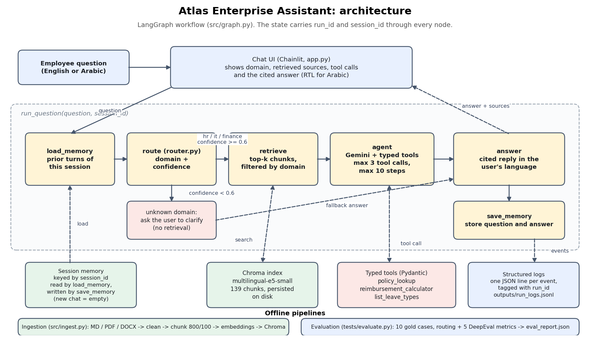

# Atlas Industries Enterprise Assistant

An agentic AI-powered enterprise knowledge assistant that helps employees find reliable answers to internal **HR, IT, and Finance policies** using Retrieval-Augmented Generation (RAG).

The assistant supports English and Arabic, retrieves relevant internal documents, provides source references, maintains conversation memory, and uses typed tools for selected policy-related tasks. Its workflow is orchestrated with LangGraph and evaluated using DeepEval.

> **Project:** AI & Machine Learning Boot Camp Graduation Project  
> **Organization:** Atlas Industries (fictional company)  
> **Repository:** [Mariam-abd-elhady/atlas-enterprise-assistant](https://github.com/Mariam-abd-elhady/atlas-enterprise-assistant)

## Demo

The following animation demonstrates the application workflow.


## Features

- **Bilingual assistance:** Handles employee questions in English and Arabic.
- **Domain-aware routing:** Classifies questions into HR, IT, or Finance and requests clarification when confidence is insufficient.
- **Retrieval-Augmented Generation:** Retrieves relevant passages from the internal document collection before generating answers.
- **Source references:** Identifies the documents used to support answers.
- **Session memory:** Maintains conversational context within a session.
- **Typed tools:** Provides structured policy lookup, reimbursement calculation, and leave-type functionality.
- **Observability:** Records execution information, including run IDs and structured logs.
- **Evaluation:** Measures routing, citation coverage, faithfulness, answer relevancy, and retrieval-related metrics.

## Tech Stack

| Component | Technology |
|---|---|
| Language | Python |
| LLM | Google Gemini API |
| Workflow orchestration | LangGraph |
| LLM integration | LangChain |
| Embeddings | `intfloat/multilingual-e5-small` |
| Vector database | ChromaDB |
| User interface | Chainlit |
| Data validation | Pydantic |
| Evaluation | DeepEval |
| Document formats | Markdown, PDF, DOCX |

## Project Architecture



The application follows a retrieval-augmented, graph-based workflow:

1. **Load memory:** Retrieves available conversation context.
2. **Route:** Classifies the question into HR, IT, or Finance.
3. **Retrieve:** Searches the relevant domain's indexed documents.
4. **Agent:** Uses the retrieved context and available typed tools to formulate a response.
5. **Answer:** Returns the response with source references.
6. **Save memory:** Stores conversation information for subsequent turns.

If the question cannot be routed confidently, the assistant can ask the user to clarify the intended domain rather than making an unsupported assumption.

## Getting Started

### Prerequisites

Before running the project, ensure you have:

- Python installed and available from PowerShell.
- Git installed.
- A Google Gemini API key.
- An internet connection for initial dependency installation and embedding-model download.

### 1. Clone the repository

Open PowerShell and run:

```powershell
git clone https://github.com/Mariam-abd-elhady/atlas-enterprise-assistant.git
cd atlas-enterprise-assistant
```

### 2. Create and activate a virtual environment

```powershell
python -m venv .venv
.\.venv\Scripts\Activate.ps1
```

If PowerShell blocks script activation, you can run the environment's Python executable directly instead:

```powershell
.\.venv\Scripts\python.exe -m pip install -r requirements.txt
```

### 3. Install dependencies

With the virtual environment activated:

```powershell
python -m pip install -r requirements.txt
```

### 4. Configure environment variables

Create a local `.env` file from the example:

```powershell
Copy-Item .env.example .env
```

Open `.env` and replace the placeholder with your own Gemini API key:

```env
GOOGLE_API_KEY=your_actual_api_key
```

Keep your real `.env` file private. Only `.env.example`, containing a placeholder, should be committed to GitHub.

### 5. Build the document index

Run:

```powershell
python -m src.ingest
```

The ingestion pipeline processes the provided corpus, prepares document chunks, generates embeddings, and stores them in the local Chroma index.

The initial run may take several minutes because the embedding model needs to be downloaded. Subsequent runs can reuse locally cached model files.

**Important:** Use the repository's existing `data/docs/` files. On Windows, avoid manually extracting the original corpus archive over these files, as Arabic filenames may cause problems.

### 6. Launch the application

```powershell
chainlit run app.py
```

Open the local URL printed in the terminal, typically:

`http://localhost:8000`

You can now ask questions about internal HR, IT, and Finance policies in English or Arabic.

## Evaluation

The project includes a set of 10 reference questions in `tests/eval_cases.jsonl` and an evaluation script in `tests/evaluate.py`.

### Run the full evaluation

```powershell
python -m tests.evaluate
```

The evaluation results are written to:

`outputs/eval_report.json`

The final analysis is documented in:

`outputs/final_report.md`

### Run a smaller evaluation

Evaluate only two cases:

```powershell
python -m tests.evaluate --limit 2
```

Run routing and citation checks without the LLM judge metrics:

```powershell
python -m tests.evaluate --skip-metrics
```

The last results recorded in the project documentation were:

| Metric | Reported result |
|---|---:|
| Routing accuracy | 100% |
| Citation recall | 95% |
| Faithfulness | 0.93 |
| Answer relevancy | 0.93 |
| Hallucination score (1 = none) | 1.00 |
| Contextual precision | 0.82 |
| Contextual recall | 0.82 |

These figures describe the recorded evaluation run; they should not be interpreted as a guarantee that every answer is correct.

### Evaluation limitations

- The evaluation contains only 10 reference questions.
- The keyword-based router may perform differently on questions outside the evaluation set.
- Retrieval can miss passages containing specific figures, such as reimbursement limits or per-diem rates.
- LLM-based evaluation may not detect an incorrect answer when the retrieved context itself is incomplete or incorrect.
- The same model family was used for answer generation and judging in the recorded run, which limits evaluation independence.
- The provided evaluation questions did not exercise the available tools, so tool use requires separate testing.
- Gemini API availability and free-tier quotas may affect evaluation runtime and completion.

See `outputs/final_report.md` and `notebooks/03_eval_walkthrough.ipynb` for the recorded results and further analysis.

## Repository Structure

```text
atlas-enterprise-assistant/
├── README.md
├── LICENSE
├── requirements.txt
├── .env.example
├── .gitignore
├── app.py
├── CONTRACT.md
├── src/
│   ├── __init__.py
│   ├── settings.py
│   ├── prompts.py
│   ├── graph.py
│   ├── router.py
│   ├── retriever.py
│   ├── memory.py
│   ├── ingest.py
│   ├── embeddings.py
│   ├── schemas.py
│   ├── tools.py
│   └── logging_setup.py
├── tests/
│   ├── __init__.py
│   ├── evaluate.py
│   └── eval_cases.jsonl
├── data/
│   └── docs/
│       ├── hr/
│       ├── it/
│       └── finance/
├── outputs/
│   ├── eval_report.json
│   ├── run_logs.jsonl
│   └── final_report.md
├── notebooks/
│   ├── 01_eda.ipynb
│   ├── 02_retrieval.ipynb
│   └── 03_eval_walkthrough.ipynb
├── docs/
│   ├── demo.gif
│   ├── architecture.png
│   └── corpus_readme.md
└── scripts/
    └── reset.py
```

The local `index/` directory contains the generated vector index. Follow the repository's `.gitignore` and project instructions when deciding whether generated index files should be included in version control.

## Maintenance

### Rebuild the index

The repository provides a reset script:

```powershell
python -m scripts.reset
```

Use this when you intentionally need to reset and rebuild the local index. Check the script before running it, because resetting can remove the existing index.

### Code quality

The repository includes Ruff configuration. If the corresponding tools are installed, run:

```powershell
ruff check .
```

## Security

- Never commit `.env` or expose API keys in source code, notebooks, logs, or screenshots.
- Keep `.env.example` limited to placeholder values.
- Review generated logs and evaluation artifacts before publishing them.
- Do not include private employee information in the fictional knowledge corpus or public demonstrations.

## License

This project is distributed under the MIT License. See [LICENSE](LICENSE) for details.
